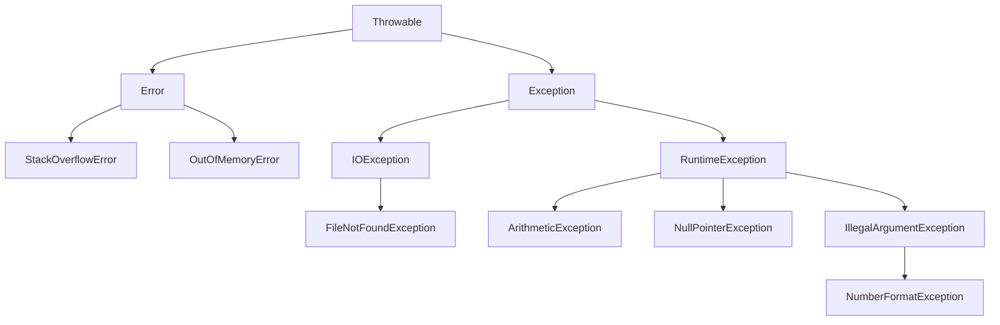

# Java Chapter 2: Abstraction & Exception Handling

Study notes for **Part 3 (Abstraction)** and **Part 4 (Exception Handling)** of *Chapter 2: Inheritance, Polymorphism, Abstraction & Exceptions*.

Each topic has a plain-English explanation, the example from the lecture, and at least one **extra example** that isn't in the slides.

---

## Table of Contents

**Part 3: Abstraction**
1. [The problem: "just a bank account"](#1-the-problem-just-a-bank-account)
2. [What is an abstract class?](#2-what-is-an-abstract-class)
3. [Abstract methods](#3-abstract-methods)
4. [Rules for subclasses](#4-rules-for-subclasses)
5. [Full example: abstract BankAccount](#5-full-example-abstract-bankaccount)
6. [Extra examples](#6-extra-examples-abstraction)
7. [Quiz: will it compile?](#7-quiz-will-it-compile)

**Part 4: Exception Handling**

8. [What is an exception?](#8-what-is-an-exception)
9. [try and catch](#9-try-and-catch)
10. [The three kinds of exceptions](#10-the-three-kinds-of-exceptions)
11. [Checked exceptions: catch or specify](#11-checked-exceptions-catch-or-specify)
12. [Unchecked exceptions: fix the bug](#12-unchecked-exceptions-fix-the-bug)
13. [Don't use an empty catch](#13-dont-use-an-empty-catch)
14. [Multiple catch blocks](#14-multiple-catch-blocks)
15. [finally](#15-finally)
16. [throw](#16-throw)
17. [throws](#17-throws)
18. [throw vs throws](#18-throw-vs-throws)
19. [The exception class hierarchy](#19-the-exception-class-hierarchy)
20. [Custom exceptions](#20-custom-exceptions)
21. [Chapter review: true or false?](#21-chapter-review-true-or-false)
22. [Cheat sheet](#22-cheat-sheet)

---

# Part 3: Abstraction

## 1. The problem: "just a bank account"

A bank has three kinds of account: **Savings**, **Current** and **Student**. Every real account is one of these three. Nobody ever opens "just a bank account".

But with normal inheritance, nothing stops this:

```java
BankAccount c = new BankAccount("BAS-1", 100);   // what kind of account is this??
```

Two questions come up:

- Should anyone be allowed to create a plain `BankAccount`? **No.**
- Every subclass overrides `withdraw()` with its own rules. So what should the parent's `withdraw()` do? **Nothing. It shouldn't have a body at all.**

**Abstraction** fixes both problems.

---

## 2. What is an abstract class?

An **abstract class** is a **blueprint** for other classes. You mark it with the `abstract` keyword.

| An abstract class... | |
|---|---|
| **cannot** be created with `new` | `new BankAccount(...)` won't compile |
| **can** be extended | `class SavingsAccount extends BankAccount` |
| **can** have fields | `protected double balance;` |
| **can** have normal (concrete) methods | shared by all subclasses |
| **can** have a constructor | subclasses call it with `super(...)` |
| **can** have abstract methods | methods with no body |

> [!NOTE]
> "Abstract classes can't be instantiated, but they can be subclassed. That's the entire point."

**Everyday analogy:** "Vehicle" is an abstract idea. You can't buy *a vehicle*. You buy a car, a bus or a motorbike. But all of them share things a vehicle has (wheels, speed, a `move()` action).

---

## 3. Abstract methods

An **abstract method** has a name and parameters but **no body**. It ends with a semicolon instead of `{ }`.

```java
abstract void draw();      // no body: every subclass must write its own
```

It says: *"Every subclass must have this method, but each one does it differently."*

An abstract class can mix abstract and concrete methods:

```java
public abstract class GraphicObject {
    int x, y;                            // concrete field

    void moveTo(int nx, int ny) {        // concrete method: shared by all shapes
        x = nx;
        y = ny;
    }

    abstract void draw();                // abstract: no body
    abstract void resize();              // abstract: subclasses must implement
}
```

> [!IMPORTANT]
> If a class has **even one** abstract method, the class itself **must** be declared `abstract`.

---

## 4. Rules for subclasses

A subclass of an abstract class has two choices:

1. **Implement every abstract method** → it becomes a normal (concrete) class you can create with `new`, **or**
2. **Declare itself `abstract` too** → it passes the job down to its own subclasses.

If it does neither, you get a **compile-time error**.

```java
public class Circle extends GraphicObject {
    private int radius;

    @Override
    public void draw() {
        System.out.println("circle");
    }

    @Override
    public void resize() {
        if (radius < 100)
            radius *= 2;
    }
}
```

When implementing an abstract method:

- Same name, same parameters.
- The return type may be a subclass of the original (covariant return).
- Visibility may get **wider** (e.g. package-private → `public`), never narrower.

---

## 5. Full example: abstract BankAccount

The parent holds what is **shared**. Each child writes its own `withdraw()` rule.

```java
abstract class BankAccount {
    private String accountNumber;
    protected double balance;

    BankAccount(String accountNumber, double balance) {   // abstract classes CAN have constructors
        this.accountNumber = accountNumber;
        this.balance = balance;
    }

    abstract void withdraw(double amount);   // no body: each subclass must implement it

    void deposit(double amount) {            // concrete: shared by all accounts
        if (amount <= 0) refuse("deposit must be more than 0");
        else balance += amount;
    }

    void refuse(String why) {
        System.out.println("  " + accountNumber + " refused: " + why);
    }

    void show() {
        System.out.println("  " + accountNumber + " balance: " + balance);
    }
}

class SavingsAccount extends BankAccount {
    SavingsAccount(String n, double b) { super(n, b); }

    @Override
    void withdraw(double amount) {           // rule: keep at least 50
        if (balance - amount < 50) refuse("must keep at least 50");
        else balance -= amount;
    }
}

class CurrentAccount extends BankAccount {
    CurrentAccount(String n, double b) { super(n, b); }

    @Override
    void withdraw(double amount) {           // rule: overdraft down to -200
        if (balance - amount < -200) refuse("overdraft limit is 200");
        else balance -= amount;
    }
}

class StudentAccount extends BankAccount {
    StudentAccount(String n, double b) { super(n, b); }

    @Override
    void withdraw(double amount) {           // rule: max 100 each time
        if (amount > 100) refuse("max 100 per withdrawal");
        else if (amount > balance) refuse("not enough money");
        else balance -= amount;
    }
}

public class AbstractAccountDemo {
    public static void main(String[] args) {
        // BankAccount x = new BankAccount("BAS-1", 100);   // ✗ cannot be instantiated

        BankAccount acc1 = new SavingsAccount("SAV-1", 200);
        BankAccount acc2 = new CurrentAccount("CUR-1", 200);
        BankAccount acc3 = new StudentAccount("STU-1", 200);

        acc1.deposit(50);  acc1.withdraw(300);  acc1.show();
        acc2.deposit(50);  acc2.withdraw(300);  acc2.show();
        acc3.deposit(50);  acc3.withdraw(300);  acc3.show();
    }
}
```

**Output:**

```
  SAV-1 refused: must keep at least 50
  SAV-1 balance: 250.0
  CUR-1 balance: -50.0
  STU-1 refused: max 100 per withdrawal
  STU-1 balance: 250.0
```

**What to notice:**

- The variable type is `BankAccount`, but the **real object** decides which `withdraw()` runs (polymorphism).
- `deposit()` and `show()` are written **once** in the parent and reused by all three.
- `new BankAccount(...)` gives: `error: BankAccount is abstract; cannot be instantiated`.

---

## 6. Extra examples (Abstraction)

### Extra 1: Shapes and area

Every shape has an area, but each calculates it differently.

```java
abstract class Shape {
    private String name;

    Shape(String name) { this.name = name; }

    abstract double area();                  // each shape knows its own formula

    void describe() {                        // shared
        System.out.println(name + " has area " + area());
    }
}

class Rectangle extends Shape {
    private double width, height;

    Rectangle(double w, double h) {
        super("Rectangle");
        width = w;
        height = h;
    }

    @Override
    double area() { return width * height; }
}

class Circle extends Shape {
    private double radius;

    Circle(double r) {
        super("Circle");
        radius = r;
    }

    @Override
    double area() { return Math.PI * radius * radius; }
}

public class ShapeDemo {
    public static void main(String[] args) {
        Shape[] shapes = { new Rectangle(4, 5), new Circle(1) };
        for (Shape s : shapes) {
            s.describe();
        }
    }
}
```

```
Rectangle has area 20.0
Circle has area 3.141592653589793
```

`describe()` calls `area()` without knowing which shape it is. That's the power of abstraction.

### Extra 2: Employees and pay

```java
abstract class Employee {
    protected String name;

    Employee(String name) { this.name = name; }

    abstract double monthlyPay();

    void printPayslip() {
        System.out.println(name + ": $" + monthlyPay());
    }
}

class FullTimeEmployee extends Employee {
    private double salary;

    FullTimeEmployee(String name, double salary) {
        super(name);
        this.salary = salary;
    }

    @Override
    double monthlyPay() { return salary / 12; }
}

class PartTimeEmployee extends Employee {
    private int hours;
    private double rate;

    PartTimeEmployee(String name, int hours, double rate) {
        super(name);
        this.hours = hours;
        this.rate = rate;
    }

    @Override
    double monthlyPay() { return hours * rate; }
}
```

```java
Employee a = new FullTimeEmployee("Amina", 36000);
Employee h = new PartTimeEmployee("Hodan", 80, 15);
a.printPayslip();   // Amina: $3000.0
h.printPayslip();   // Hodan: $1200.0
```

### Extra 3: An abstract class in the middle of a chain

A subclass that doesn't implement the abstract method must stay abstract:

```java
abstract class Animal {
    abstract void makeSound();
}

abstract class Pet extends Animal {     // still abstract: makeSound() not written yet
    void play() { System.out.println("Playing!"); }
}

class Cat extends Pet {
    @Override
    void makeSound() { System.out.println("Meow"); }   // finally implemented
}
```

`new Pet()` ✗ won't compile. `new Cat()` ✓ works.

---

## 7. Quiz: will it compile?

`BankAccount` is abstract with `abstract void withdraw(double a);`

```java
// 1
abstract class BankAccount {
    BankAccount(String n, double b) { ... }
}

// 2
class FixedAccount extends BankAccount {
    FixedAccount(String n, double b) { super(n, b); }
}   // no withdraw()

// 3
abstract void withdraw(double a) {
    balance -= a;
}

// 4
BankAccount acc = new CurrentAccount("CUR-1", 200);
```

<details>
<summary><b>Show answers</b></summary>

1. ✓ **Compiles.** Abstract classes can have constructors. Subclasses call them with `super(...)`.
2. ✗ **Error.** `FixedAccount` doesn't implement `withdraw()` and isn't abstract.
3. ✗ **Error.** An abstract method can't have a body.
4. ✓ **Compiles.** A parent-type variable can hold a concrete child object.

</details>

---

# Part 4: Exception Handling

## 8. What is an exception?

> An exception is *"an event, which occurs during the execution of a program, that disrupts the normal flow of the program's instructions."*

In simple words: **something went wrong while the program was running**. Java creates an **object** that describes the problem and "throws" it.

### The crash without handling

A customer meant to type `500` but typed `50o` (letter **o**, not zero):

```java
String input = "50o";
int amount = Integer.parseInt(input);              // 💥 crash here
System.out.println("Withdrawing " + amount);       // never runs
System.out.println("Back to main menu");           // never runs
```

```
Exception in thread "main" java.lang.NumberFormatException: For input string: "50o"
    at java.lang.Integer.parseInt(Integer.java:662)
    at AtmDemo.main(AtmDemo.java:4)
```

### What Java does, in 3 steps

| Step | What happens |
|---|---|
| **1. Detect and throw** | `parseInt` can't read `"50o"`. It creates a `NumberFormatException` object and throws it. |
| **2. Walk the call stack** | Java looks for a `catch`: first in `parseInt`, then in `main`. |
| **3. Handle or terminate** | If a `catch` is found, it runs. If not, the program **stops** and prints the error. |

### Real-life examples

| Situation | Good response |
|---|---|
| ATM network fails mid-transaction | Cancel safely, keep balance unchanged, show a message |
| Withdrawal larger than balance | Throw `InsufficientBalanceException`, show available balance |
| Online shop can't reach payment gateway | Keep the cart, offer to retry |
| Student ID already exists | Throw `DuplicateException`, ask for a different ID |

---

## 9. try and catch

- **`try`** wraps code that **might** fail.
- **`catch`** runs **only if** that kind of exception happens.

```java
try {
    // risky code
} catch (ExceptionType e) {
    // what to do if it fails
}
```

### Same ATM code, now handled

```java
String input = "50o";
try {
    int amount = Integer.parseInt(input);              // 1. error occurs
    System.out.println("Withdrawing " + amount);       //    skipped
} catch (NumberFormatException e) {                    // 2. exception goes to catch
    System.out.println("Please enter digits only");    // 3. tell the user
}
System.out.println("Back to main menu");               // 4. program continues
```

```
Please enter digits only
Back to main menu
```

No crash. 🎉

### Using the exception object `e`

`e` is the exception object. `e.getMessage()` tells you what went wrong.

```java
try {
    int amount = Integer.parseInt("50o");
} catch (NumberFormatException e) {
    System.out.println("Invalid amount: " + e.getMessage());
}
// Invalid amount: For input string: "50o"
```

A **parent** type also catches its children (inheritance again!):

```java
} catch (Exception e) {     // Exception is the parent of NumberFormatException
    System.out.println("Caught by Exception: " + e.getMessage());
}
```

> [!IMPORTANT]
> - A `try` alone is not allowed. It must be followed by `catch`, `finally`, or both.
> - No code can go between the end of `try` and the first `catch`.

### Extra example: student marks

```java
String marksInput = "8o";   // lecturer typed letter o instead of 0
try {
    int marks = Integer.parseInt(marksInput);
    System.out.println("Marks saved: " + marks);
} catch (NumberFormatException e) {
    System.out.println("Marks must be a number");
}
System.out.println("Back to student menu");
```

| Input | Output |
|---|---|
| `"8o"` | `Marks must be a number` → `Back to student menu` |
| `"80"` | `Marks saved: 80` → `Back to student menu` |

### Extra example: array index

```java
int[] scores = {70, 85, 90};
try {
    System.out.println(scores[5]);
} catch (ArrayIndexOutOfBoundsException e) {
    System.out.println("There is no score at that position");
}
```

---

## 10. The three kinds of exceptions

| Kind | When is it found? | What it means | Examples | What to do |
|---|---|---|---|---|
| **Checked** | At **compile time** | A problem you should expect and recover from | `IOException`, `FileNotFoundException`, `SQLException` | **Must** catch or declare (`throws`) |
| **Runtime** (unchecked) | While **running** | Usually a **bug** in your code | `NullPointerException`, `ArithmeticException`, `ArrayIndexOutOfBoundsException`, `NumberFormatException` | Usually **fix the bug** |
| **Error** (unchecked) | While **running** | The JVM itself is in trouble | `StackOverflowError`, `OutOfMemoryError` | Don't catch. Fix the cause. |

> [!TIP]
> **Rule of thumb:** problems you can recover from → **checked**. Bugs and system failures → **unchecked**.

### With code you know

```java
// CHECKED: won't even compile
void withdraw(double a) throws Exception { ... }
acc.withdraw(500);    // ✗ error: unreported exception Exception; must be caught or declared to be thrown

// RUNTIME: compiles, crashes when run
Integer.parseInt("50o");                // NumberFormatException
int avg = totalMarks / courses;         // ArithmeticException: / by zero  (when courses = 0)
Student s = null;  s.getGpa();          // NullPointerException

// ERROR: the JVM runs out of stack
void deposit(double a) {
    deposit(a);                         // calls itself forever → StackOverflowError
}
```

---

## 11. Checked exceptions: catch or specify

For a **checked** exception, Java forces you to do **one of two things**. This is called the **Catch or Specify Requirement**:

```java
void withdraw(double a) throws Exception {          // checked
    if (a > balance) throw new Exception("Insufficient balance");
    balance -= a;
}
```

**Option 1: Catch it** (handle it here)

```java
try {
    acc.withdraw(500);
} catch (Exception e) {
    System.out.println("Refused: " + e.getMessage());
}
System.out.println("Back to main menu");
```

```
Refused: Insufficient balance
Back to main menu
```

✅ Handled. The program continues.

**Option 2: Specify it** (pass it to whoever called you)

```java
public static void main(String[] args) throws Exception {
    acc.withdraw(500);
    System.out.println("Back to main menu");
}
```

```
Exception in thread "main" java.lang.Exception: Insufficient balance
```

⚠️ It compiles, but nobody handles it, so the program crashes.

### Extra example: student registration

A student may register for at most 6 courses. Hodan already has 6.

```java
void registerCourse(String code) throws Exception {
    if (courses >= 6) throw new Exception("Maximum 6 courses");
    courses++;
}

try {
    hodan.registerCourse("CA314");
} catch (Exception e) {
    System.out.println("Registration refused: " + e.getMessage());
}
// Registration refused: Maximum 6 courses
```

---

## 12. Unchecked exceptions: fix the bug

Unchecked exceptions (`RuntimeException` and `Error`) **don't** need `throws` or `try/catch`. Java won't force you.

Most of them are **bugs**, so the right answer is usually an `if`, not a `catch`:

| Problem | ❌ Buggy code | ✅ Fix |
|---|---|---|
| Divide by 0 | `avg = totalMarks / courses;` | `if (courses > 0) avg = totalMarks / courses;`<br>`else System.out.println("No courses yet");` |
| `null` object | `s.getGpa();` | `if (s != null) System.out.println(s.getGpa());`<br>`else System.out.println("No student selected");` |
| User typed `"50o"` | `Integer.parseInt(input);` | **Catch it.** You can't control what users type. |

> [!TIP]
> Use `if` to **prevent** bugs in your own code. Use `catch` for problems that come from **outside** (user input, files, network).

---

## 13. Don't use an empty catch

A customer deposits `"1oo"` (letters o). Balance before: 200.

**❌ Empty catch, which hides the problem:**

```java
try {
    int amount = Integer.parseInt("1oo");
    acc.deposit(amount);
} catch (NumberFormatException e) {
    // nothing here
}
System.out.println("Deposit complete. Thank you!");
System.out.println("Balance: " + acc.getBalance());
```

```
Deposit complete. Thank you!     ← a lie!
Balance: 200.0
```

**✅ Tell the user:**

```java
try {
    int amount = Integer.parseInt("1oo");
    acc.deposit(amount);
    System.out.println("Deposit complete.");
} catch (NumberFormatException e) {
    System.out.println("Invalid amount. Nothing was deposited.");
}
System.out.println("Balance: " + acc.getBalance());
```

```
Invalid amount. Nothing was deposited.
Balance: 200.0
```

A good `catch` block can **log** the error, **tell the user**, **retry**, **throw a different exception**, or **shut down safely**. It should never do nothing.

---

## 14. Multiple catch blocks

Different problems deserve different responses. Order matters: **specific first, general last.**

```java
try {
    int amount = Integer.parseInt(input);   // bad typing?
    acc.withdraw(amount);                   // not enough money?
    System.out.println("Please take your cash");
} catch (NumberFormatException e) {         // specific
    System.out.println("Digits only, please");
} catch (Exception e) {                     // general
    System.out.println("Refused: " + e.getMessage());
}
```

| Input (balance 200) | Output |
|---|---|
| `"100"` | `Please take your cash` |
| `"500"` | `Refused: Insufficient balance` |
| `"50o"` | `Digits only, please` |

### Wrong order = compile error

```java
catch (Exception e) { ... }
catch (NumberFormatException e) { ... }
// ✗ error: exception NumberFormatException has already been caught
```

`Exception` already catches everything below it, so the second `catch` can never run.

### Multi-catch (Java 7+)

If two exceptions need the **same** response, join them with `|`:

```java
try {
    int avg = Integer.parseInt(marks) / courses;
} catch (NumberFormatException | ArithmeticException e) {
    System.out.println("Cannot compute average");
}
```

### Extra example: entering a GPA

```java
static void enterGpa(Student s, String input) {
    try {
        double gpa = Double.parseDouble(input);
        s.setGpa(gpa);                              // throws if not 0.0–4.0
    } catch (NumberFormatException e) {             // child
        System.out.println("GPA must be a number");
    } catch (IllegalArgumentException e) {          // parent
        System.out.println("Refused: " + e.getMessage());
    }
}
```

| Input | Output |
|---|---|
| `"3.5"` | `Amina's GPA set to 3.5` |
| `"4.5"` | `Refused: GPA must be between 0.0 and 4.0` |
| `"3.9x"` | `GPA must be a number` |

> `NumberFormatException` **is a** child of `IllegalArgumentException`, so the child must come first.

---

## 15. finally

`finally` runs **every time** the `try` finishes: on success, on exception, even after a `return`. Use it for **cleanup** (closing files, releasing resources, final logging).

```java
static void atm(BankAccount acc, String input) {
    try {
        int amount = Integer.parseInt(input);
        acc.withdraw(amount);
        System.out.println("Please take your cash");
    } catch (NumberFormatException e) {
        System.out.println("Digits only, please");
    } catch (Exception e) {
        System.out.println("Refused: " + e.getMessage());
    } finally {
        System.out.println("Card returned");    // always
    }
}
```

| Input (balance 200) | Output |
|---|---|
| `"100"` | `Please take your cash` → `Card returned` |
| `"500"` | `Refused: Insufficient balance` → `Card returned` |
| `"50o"` | `Digits only, please` → `Card returned` |

Success, refusal or bad input: **the ATM always returns your card.**

### Extra example: closing a file

```java
PrintWriter out = null;
try {
    out = new PrintWriter("out.txt");
    out.println("hello");
} catch (IOException e) {
    System.err.println(e.getMessage());
} finally {
    if (out != null) out.close();   // file always gets closed
}
```

### Extra example: finally even after return

```java
static String check(int age) {
    try {
        if (age < 18) return "Too young";
        return "Welcome";
    } finally {
        System.out.println("Check finished");   // still prints!
    }
}
```

```java
System.out.println(check(15));
// Check finished
// Too young
```

---

## 16. throw

`throw` **creates and fires** an exception yourself. Use it when your method gets bad data.

```java
// in BankAccount
void deposit(double amount) {
    if (amount <= 0) {
        throw new IllegalArgumentException("Deposit must be more than 0");
    }
    balance += amount;
    System.out.println("Deposited " + amount);
}
```

```java
try {
    acc.deposit(100);   // OK
    acc.deposit(-50);   // throws
    acc.deposit(20);    // skipped!
} catch (IllegalArgumentException e) {
    System.out.println("Refused: " + e.getMessage());
}
```

```
Deposited 100.0
Refused: Deposit must be more than 0
```

**What `throw` does:**
1. Creates an exception object with a message.
2. **Stops** the method immediately. The balance is not changed.
3. Jumps to the caller's matching `catch`. The rest of the `try` is skipped.

> [!NOTE]
> Only `Throwable` types (exceptions and errors) can be thrown.

### Extra example: setting a GPA

```java
void setGpa(double gpa) {
    if (gpa < 0 || gpa > 4.0) {
        throw new IllegalArgumentException("GPA must be between 0.0 and 4.0");
    }
    this.gpa = gpa;
}
```

### Extra example: setting an age

```java
void setAge(int age) {
    if (age < 0 || age > 150) {
        throw new IllegalArgumentException("Age must be 0–150, got " + age);
    }
    this.age = age;
}
```

---

## 17. throws

`throws` goes in the **method signature**. It warns callers: *"This method might throw this exception. **You** deal with it."*

```java
public List<String> loadFile(String path) throws IOException {
    return Files.readAllLines(Path.of(path));
}
```

### Passing an exception up the chain

Each method decides: **handle it here**, or **pass it up**.

```java
// 1. withdraw() THROWS it
void withdraw(double a) throws Exception {
    if (a > balance) throw new Exception("Insufficient balance");
    balance -= a;
}

// 2. atm() PASSES IT UP (no try/catch)
static void atm(BankAccount acc, int amount) throws Exception {
    acc.withdraw(amount);
    System.out.println("Please take your cash");   // never prints if withdraw fails
}

// 3. main() CATCHES it
try {
    atm(acc, 500);
} catch (Exception e) {
    System.out.println("Refused: " + e.getMessage());
}
System.out.println("Back to main menu");
```

```
Refused: Insufficient balance
Back to main menu
```

```
withdraw()  ──throws──▶  atm()  ──passes up──▶  main()  ──catches──▶  ✅
```

> [!NOTE]
> `throws` is **required** for checked exceptions. For unchecked ones it's optional (just documentation).

---

## 18. throw vs throws

| | `throw` | `throws` |
|---|---|---|
| **Job** | Actually **fires** an exception | **Warns** that a method might |
| **Form** | `throw new XException("...");` | `void m() throws XException` |
| **Where** | Inside the method body | In the method signature |
| **Followed by** | **One** exception object | A **list** of exception classes |
| **Effect** | Jumps to a handler | Moves the handling job to the caller |

> 🧠 **Memory hook:** `throw` is the **action** (raise one exception now). `throws` is the **warning label** on the method.

---

## 19. The exception class hierarchy



- **Unchecked** = `Error` and everything under `RuntimeException`.
- **Checked** = everything else under `Exception` (like `IOException`).
- **Catching a parent catches all its children.** `catch (Exception e)` catches almost anything.

---

## 20. Custom exceptions

Built-in exceptions are general. Your app has its own problems: **insufficient balance**, **course full**, **duplicate ID**, **invalid grade**. A custom exception gives the problem a clear name and can carry extra data.

**Why bother?**
- Catch only the failures **your** program cares about.
- Carry extra information (e.g. how much money is missing).
- Clearer error messages and stack traces.

**How to make one:**

| Extend... | You get... |
|---|---|
| `Exception` | a **checked** exception (callers must catch or declare) |
| `RuntimeException` | an **unchecked** exception |

Always end the name with `Exception`.

### Example: InsufficientBalanceException

```java
class InsufficientBalanceException extends Exception {   // checked
    private double shortfall;                           // extra data

    InsufficientBalanceException(String message, double shortfall) {
        super(message);                                 // so getMessage() works
        this.shortfall = shortfall;
    }

    double getShortfall() { return shortfall; }
}
```

```java
// in BankAccount (balance = 200)
void withdraw(double amount) throws InsufficientBalanceException {
    if (amount > balance) {
        throw new InsufficientBalanceException("Insufficient balance", amount - balance);
    }
    balance -= amount;
}
```

```java
// in main
try {
    acc.withdraw(500);
} catch (InsufficientBalanceException e) {
    System.out.println(e.getMessage() + ": you need " + e.getShortfall() + " more");
}
System.out.println("Back to main menu");
```

```
Insufficient balance: you need 300.0 more
Back to main menu
```

The **name** says *what* went wrong. `shortfall` says *by how much*.

### Example: CourseFullException

```java
class CourseFullException extends Exception {
    private int limit;

    CourseFullException(String message, int limit) {
        super(message);
        this.limit = limit;
    }

    int getLimit() { return limit; }
}

// in Student
void registerCourse(String code) throws CourseFullException {
    if (courses >= 6) throw new CourseFullException("Maximum 6 courses", 6);
    courses++;
}

// in main
try {
    hodan.registerCourse("CA314");
} catch (CourseFullException e) {
    System.out.println(e.getMessage() + " (limit: " + e.getLimit() + ")");
}
// Maximum 6 courses (limit: 6)
```

### Extra example: unchecked InvalidGradeException

```java
class InvalidGradeException extends RuntimeException {   // unchecked: no throws needed
    InvalidGradeException(String message) {
        super(message);
    }
}

// in Student
void setGpa(double gpa) {
    if (gpa < 0 || gpa > 4.0) {
        throw new InvalidGradeException("GPA must be 0.0 to 4.0, got " + gpa);
    }
    this.gpa = gpa;
}

// in main
try {
    amina.setGpa(4.5);
} catch (InvalidGradeException e) {
    System.out.println(e.getMessage());
}
// GPA must be 0.0 to 4.0, got 4.5
```

### Extra example: library book

```java
class BookNotAvailableException extends Exception {
    BookNotAvailableException(String title) {
        super("'" + title + "' is already borrowed");
    }
}

class Book {
    private String title;
    private boolean borrowed;

    Book(String title) { this.title = title; }

    void borrow() throws BookNotAvailableException {
        if (borrowed) throw new BookNotAvailableException(title);
        borrowed = true;
        System.out.println("You borrowed '" + title + "'");
    }
}

public class LibraryDemo {
    public static void main(String[] args) {
        Book b = new Book("Clean Code");
        try {
            b.borrow();     // OK
            b.borrow();     // throws
        } catch (BookNotAvailableException e) {
            System.out.println("Sorry: " + e.getMessage());
        } finally {
            System.out.println("Thank you for visiting the library");
        }
    }
}
```

```
You borrowed 'Clean Code'
Sorry: 'Clean Code' is already borrowed
Thank you for visiting the library
```

This one example uses **custom exception + throw + throws + try/catch + finally** together.

---

## 21. Chapter review: true or false?

1. In `BankAccount acc = new SavingsAccount()`, `BankAccount`'s `withdraw()` runs.
2. An abstract class cannot have a constructor.
3. `finally` runs even when a `catch` has already handled the exception.
4. An empty `catch` block fixes the error.

<details>
<summary><b>Show answers</b></summary>

1. **False.** The **real object** (`SavingsAccount`) decides which `withdraw()` runs.
2. **False.** Abstract classes can have constructors. Subclasses call them with `super(...)`.
3. **True.** `finally` always runs.
4. **False.** It only hides the problem. The user is never told something went wrong.

</details>

---

## 22. Cheat sheet

### Abstraction

```java
abstract class Parent {           // can't use: new Parent()
    abstract void doIt();         // no body, ends with ;
    void shared() { ... }         // normal method, reused
}

class Child extends Parent {
    @Override
    void doIt() { ... }           // must implement (or be abstract too)
}
```

### Exceptions

```java
try {
    // risky code
} catch (SpecificException e) {  // specific first
    // handle
} catch (Exception e) {           // general last
    System.out.println(e.getMessage());
} finally {
    // always runs: cleanup
}

void m() throws SomeException {   // throws = warning label
    throw new SomeException("..."); // throw = fire it now
}

class MyException extends Exception {          // checked
    MyException(String msg) { super(msg); }
}
class MyBugException extends RuntimeException { // unchecked
    MyBugException(String msg) { super(msg); }
}
```

| Remember | |
|---|---|
| Checked | Compiler forces catch **or** `throws` |
| Unchecked | Usually a bug, so fix with `if` |
| Catch order | Child before parent |
| Empty catch | ❌ Never |
| `finally` | Always runs |
